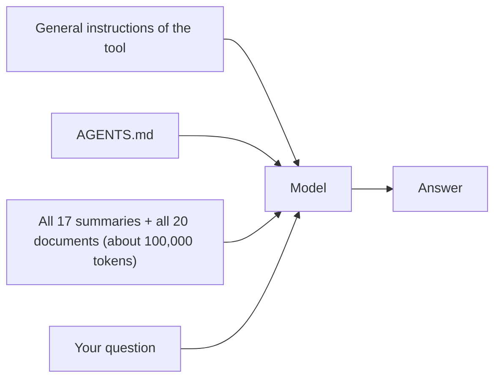
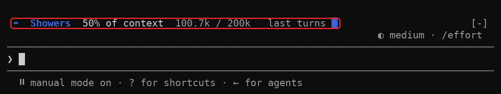
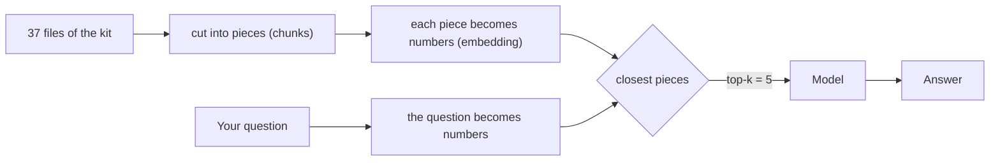
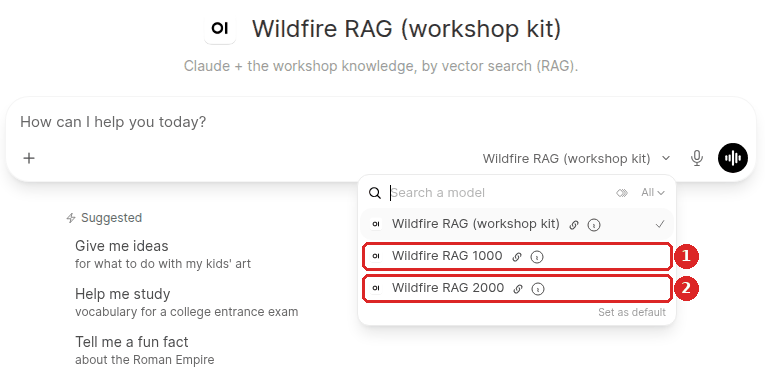
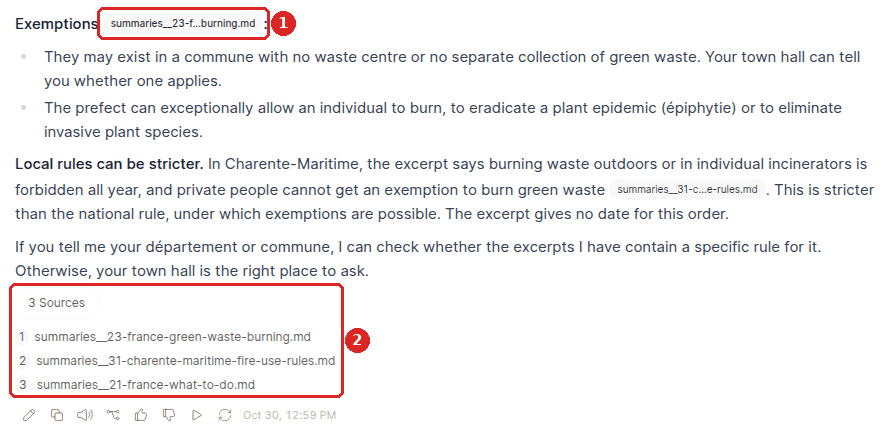
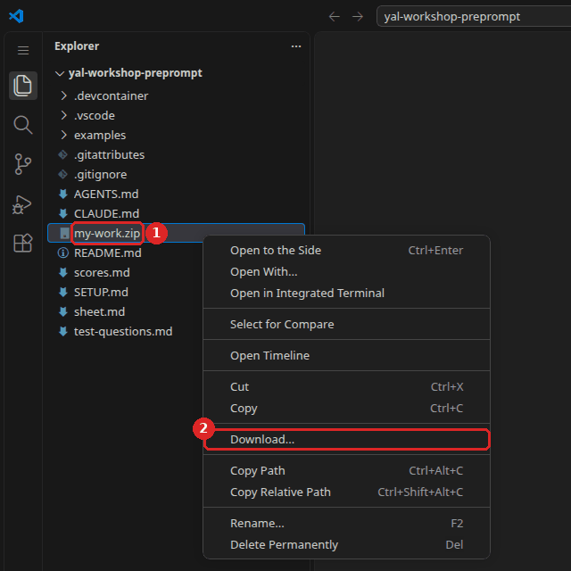

# Workshop 2 - Everything in the context, then RAG

### Youth AI Lab (Erasmus+) - series "Build your own chatbot", workshop 2 of 6

- **Project:** Youth AI Lab (Erasmus+), with five partners: L.A.B. (Aix-en-Provence, France),
  UAB (Barcelona, Spain), Perlatecnica (Naples, Italy), Digitale Wolven (Antwerp, Belgium),
  CSC Vent des Îles (La Rochelle, France).
- **The series:** [the six workshops](https://github.com/Youth-AI-Lab/yal-workshop-kit#the-series)
- **Need help?**
  - Raise your hand and ask the facilitator.
  - If something breaks, don't panic: your files stay in the Codespace.

> 🎓 **Open your Codespace** (one per pair): 👉 **https://codespaces.new/Youth-AI-Lab/yal-workshop-rag**
>
> **Before you click**, if the idle timeout of this GitHub account is not set yet: do
> [step 1 of SETUP.md](SETUP.md#step-1---let-the-codespace-wait-for-you) (1 minute).
>
> This link creates your own copy of this repository, in VS Code running in your browser. Nothing
> to install. The detailed steps are in [Part 1](#part-1---welcome-20-min).

> 📚 **The slides of the facilitator:** https://youth-ai-lab.github.io/yal-workshop/2/ (the same
> words as this page). **The short version** of this page, on one page: [sheet.md](sheet.md). The
> setup, the commands and the common problems of the whole series: [SETUP.md](SETUP.md).

### Contents

- [Goals of the session](#goals-of-the-session)
- [Part 1 - Welcome (20 min)](#part-1---welcome-20-min)
- [Part 2 - Everything in the context (★, 15 min)](#part-2---everything-in-the-context--15-min)
- [Part 3 - Unplugged: be the search engine (★, 15 min)](#part-3---unplugged-be-the-search-engine--15-min)
- [Part 4 - Pieces and embeddings (★★, 20 min)](#part-4---pieces-and-embeddings--20-min)
- [Part 5 - Change the settings (★★★, 20 min)](#part-5---change-the-settings--20-min)
- [Part 6 - RAG against everything in the context (★★, 10 min)](#part-6---rag-against-everything-in-the-context--10-min)
- [Part 7 - Closing (10 min)](#part-7---closing-10-min)
- [Troubleshooting](#troubleshooting)

---

## Goals of the session

### What you will be able to do by the end of this session

In workshop 1, your chatbot got instructions, and it said "I don't know" to the precise
questions: it had no documents. Today it gets all the knowledge of the kit (the files of the
series, copied into the repository of each workshop): 17 summaries and 20 official documents. The
whole series answers one question: *what enters the model's context,
when, and who decides?* The question of the day is:

> **Who picks the pieces?**

First, you put everything in the context and see what it costs. Then a search engine picks a few
pieces for each question, and you look at the pieces it picks. This is called **RAG**
(*Retrieval-Augmented Generation*).

| Bloom level | Parts | You will be able to... | Mode |
|---|---|---|---|
| **Understand** | 2 | Explain why putting all the knowledge in the context works on a small kit, and why it does not grow: every message pays for everything. | `B` |
| **Apply** | 3-4 | Read what a RAG gives the model for a question: its pieces (chunks), how many (top-k), and how they are found (embeddings). | `query` |
| **Analyse** | 5-6 | Show, on a question, how the size of the pieces and their number change what the model can see, and compare a RAG with "everything in the context" on cost and answers. | `query`, `RAG` |
| **Evaluate** | 7 | Say when a RAG is a good choice, and what failure it hides: it always gives something. | - |

All session long, you go on testing your chatbot with the same questions: today, columns
B and RAG of your score sheet.

### Why this approach?

The kit is small on purpose. All its knowledge fits in the context, so you can see the first
solution work, and pay for it. Then you imagine ten times more documents, and that solution stops.

Before you use a search engine on a computer, you are the search engine, with paper strips.
You will see that picking a few pieces for a question is a choice, and that a good choice is not
always possible: a fact can be cut in two, and a question with no answer still gets pieces.

The RAG runs in Open WebUI, the chat tool of the closing of workshop 1. It shows the pieces
it gave the model under each answer, so you can check what the model read.

### How this connects to WikiYouthBot

In the WikiYouthBot activity, the *Knowledge* box of the chatbot holds the documents of the group.
What the tool does with them, you cannot see from the outside. This workshop shows the two things
it can do: read everything, or search for pieces. Some chat tools switch from one to the other on
their own when the knowledge grows (see [Part 7](#part-7---closing-10-min)). You can build a
chatbot with a knowledge base for a group today with Open WebUI: see the
[Open WebUI guide](https://github.com/Youth-AI-Lab/yal-openwebui-guide).

The series goes on, one piece of the chatbot at a time:

- **Workshop 1**: the instructions, and how to test a chatbot
- **Workshop 2** (this one): all the knowledge in the context, then a RAG: who picks the pieces?
- **Workshop 3**: the model searches by itself, and skills to add a document you checked
- **Workshop 4**: tools that act outside, such as today's fire danger level
- **Workshop 5**: organise what it knows in a wiki, and pack the chatbot of your territory
- **Workshop 6**: fine-tune a small model, to sort messages before the chatbot

### Before you start

You need the same as in workshop 1: no programming, a little English, two people per screen.
**Bring `my-work.zip`**, the file you saved at the end of workshop 1. Without it, the kit's example
(Feurisson) becomes your system prompt, and you start column B from there. More in
[SETUP.md, Before you start](SETUP.md#before-you-start).

### Reference documents

All of these are in your Codespace, in the file list on the left:

- `summaries/index.md` and `corpus/index.md`: the list of the 17 summaries and of the 20 official
  documents. A readable copy of each document is in `corpus/text/`.
- `test-questions.md` and `scores.md`: the test set and your score sheet, as in workshop 1.
- `AGENTS.md`: your system prompt (from your save, or Feurisson).
- `SETUP.md`: setup, commands and common problems.

---

## Part 1 - Welcome (20 min)

**Goal**: open the Codespace of this workshop, bring back your work, and let Open WebUI prepare
its two knowledge bases in the background while you work.

### Step 1 - Open your Codespace and save your key

Follow [SETUP.md](SETUP.md#setup), steps 1 to 5, with the link at the top of this page: let the
Codespace wait for you, open it, save your key with `workshop-login`, check `Key OK`, have a first
conversation with `workshop bare`, and open a second terminal.

> 💡 **If you use OpenCode.** Same commands, after `workshop-login --engine opencode`. The judge of
> `score` and Open WebUI need an Anthropic key (`sk-ant-`). The
> [OpenCode guide, Part 4](https://github.com/Youth-AI-Lab/yal-opencode-guide#part-4---the-knowledge)
> shows the other way to give knowledge to a chatbot, by search, which is workshop 3.

> ℹ️ **No Codespace?** The same repository opens on your own computer, with Docker and VS Code: see
> the [dev containers guide](https://github.com/Youth-AI-Lab/yal-devcontainer-guide).

### Step 2 - Bring back your work, and start Open WebUI

1. **Drag `my-work.zip`** from your computer into the file list of the Codespace. If you
   downloaded it more than once, your browser may have named the newest one `my-work (1).zip`:
   drag that one, and type its exact name between quotes, for example
   `workshop-start 2 --from "my-work (1).zip"`.
2. In your first terminal, type:

   ```bash
   workshop-start 2 --from my-work.zip
   ```

   Without a save, type `workshop-start 2`. You should see your files restored, then:

   ```
   Ready for workshop 2.
   Open WebUI is starting in the background, then a second knowledge base (about 4 to 5 minutes
   the first time, 1 minute after). You can start the workshop meanwhile.
     To follow it: tail -f .workshop/openwebui-start.log   (Ctrl+C stops following, not Open WebUI)
     It is ready when the last line says READY.
   Today's page: README.md (Ctrl+Shift+V to read it as a page)
   First command: workshop B
   ```

   Check the date in the line `Restored from … (saved on …)`: it should be the end of workshop 1.

`workshop-start 2` has started two things that take a few minutes: Open WebUI itself (the first
time, a download of about 1.6 GB), then the cutting of the kit's documents into pieces of two
sizes. In the Codespaces we measured, it was ready in about 4 minutes. You do not need to wait:
Parts 2 and 3 do not use Open WebUI.

3. **To see where it is**, type in your second terminal:

   ```bash
   tail -f .workshop/openwebui-start.log
   ```

   The last line is `READY: Open WebUI is ready, with the two sizes.` when it is done. Press
   **Ctrl+C** to stop following: Open WebUI keeps running.

> 💡 **Tip.** Row 12 of `test-questions.md` still empty? Follow its section **Question 12: your
> territory** now: write the question, and the expected answer with its source. Then type
> `replay bare 12` and `replay A 12`, and score them with `score bare 12` and `score A 12`.

> 🚫 **Warning.** Open WebUI is reached through **port 3000** of your Codespace: a numbered door,
> listed in the **Ports** tab next to the terminal. It is private: only you can open it. **Never
> make port 3000 public** (Ports tab, right-click on 3000, Port Visibility). This Open WebUI has no
> accounts: anyone with the link could use your key.

> 💡 **Tip.** **Checkpoint**: `Key OK`, `Ready for workshop 2`, and the log of Open WebUI growing in
> the second terminal.

---

## Part 2 - Everything in the context (★, 15 min)

**Goal**: give the chatbot all the knowledge of the kit at once, see how full the context is, then
replay and score column B.

### What you will discover

- **Mode `B`**: your system prompt, plus all the summaries and all the readable copies of
  the documents, read at every message.
- **The size of the knowledge**: about half of the context window, sent with your first question
  (the gauge shows it after that message).
  The context window is everything the model reads before it answers: here, at most 200,000
  **tokens** (a token is a piece of a word).
- **The cost of reading everything**: every message pays for all of it, again.

### What the model reads in mode B



**Key insight:** in mode B, nobody picks. Everything enters the context, every time. The
model can find any fact, and see a contradiction between two documents, because it has both. The
price is paid at every message.

### What to do

#### Step 1 - Look at the gauge

1. Type:

   ```bash
   workshop B
   ```

   The first time, Claude Code asks again to trust this folder: press the **down arrow** to
   choose `Yes, I trust this folder`, then **Enter**. The gauge then shows `0 / 200k`: it counts
   what was sent at the last exchange, and nothing is sent yet. The kit goes with your first
   message.
2. Ask question 10: `How many hectares burnt outside the EU in 2025?`, and look at the gauge. At
   the rehearsal, it showed about **100,000 tokens out of 200,000** after this question: half of
   the window, almost all of it the kit.

   
3. Read the answer. Does it see that two documents give different figures?
4. Leave with **Ctrl+C twice**.

#### Step 2 - Predict, replay, score

1. **Predict** on paper: which questions will go up from column A to column B? Question 3? Question
   7? Question 10?
2. Replay the test set in mode B:

   ```bash
   replay B
   ```

   At the rehearsal: 1 min 35, and **$0.47**, about five times the $0.09 of mode A in workshop 1,
   because every question sends the whole kit again.
3. Score today's three questions (3, 7 and 10) with the help of the judge. This time it proposes
   a score, and you accept it (Enter) or correct it (0, 1 or 2):

   ```bash
   score B 3 7 10
   ```

   If you have time, score the other questions too (no question 12 written? leave out the 12):

   ```bash
   score B 1 2 4 5 6 8 9 11 12
   ```

   > ℹ️ **Note.** `score B` without numbers scores all the questions again, also 3, 7 and 10:
   > give the numbers. Workshop 3 compares questions 11 and 12 with column B: if you only have a
   > minute, score these two first, with `score B 11 12`.

4. **Compare columns A and B** in `scores.md`, for questions 3, 7 and 10, and with your prediction.
   Compare the two totals only if both columns have all their questions scored. No column A,
   because you started without a save? Type `replay A`, then `score A`, first: with Feurisson, we
   measured 1 min 12 and $0.09 (before its last two rules were added).

### Think about it

The kit has 37 files, and they fill half of the window. **What happens with ten times more
documents?** And if your group adds one document a week? (Hint: the window has a maximum size, and
every message pays for what is in it.)

> **You built** a chatbot that reads everything. **Reused in** the *Knowledge* box of a chat tool,
> as long as the knowledge is small.

---

## Part 3 - Unplugged: be the search engine (★, 15 min)

**Goal**: do by hand what a RAG does: pick a few pieces of documents for a question, and answer
with these pieces only.

### What you will discover

- **A piece** (a *chunk*): a part of a document, cut before any question is asked.
- **A search engine** gives the model only the pieces it picks: the model never sees the rest.
- **Two failures**: the answer is cut in two pieces, and only one is picked; or there is no
  answer, and pieces are picked anyway.

### How it works

Two pairs work together. The facilitator gives an envelope of paper strips: each strip is a
sentence or a paragraph copied from a summary of the kit.

- **Pair 1 is the search engine.** It reads the question card, looks through the strips, and
  passes **3 strips** (round 1) or **2 strips** (round 2) to pair 2. It must always pass strips.
- **Pair 2 is the model.** It answers the question with the strips it received, and nothing else.
  Not its memory, not the other strips.

Then you compare the answer with question 10 or question 7 of `test-questions.md`.

### What to do

1. **Round 1 (small strips, one sentence each), question 10.** Pair 1 has 2 minutes to pass 3
   strips. Pair 2 answers in one or two sentences. Does the answer see that two sources disagree?
2. **Round 1, question 7.** Same thing. The strips about Campania are not about 2025. What does
   pair 2 answer?
3. **Round 2 (big strips, one paragraph each), question 10.** Swap roles. Pair 1 passes 2 strips.
   Is it easier to give the model both sides of the contradiction?
4. **Talk about it in your group of two pairs**: how did the search engine choose? By the words of
   the question, or by their meaning?

**Key insight:** the model can only use what it receives. If the search engine does not pick the
piece that holds the answer, the model cannot find it. And a search engine always gives something,
even when the answer exists nowhere.

> 💡 **Tip.** **This activity works with young people**, with no computer: strips of their own
> documents, a question, and a pair that plays the search engine.

---

## Part 4 - Pieces and embeddings (★★, 20 min)

**Goal**: ask Open WebUI which pieces its RAG gives the model, for three questions, and read them.

### What you will discover

- **Chunks**: Open WebUI cut the 37 files of the kit into pieces of **at most** 1,000 characters
  (a short paragraph), before any question. It cuts at the end of a paragraph, so most pieces are
  shorter: the excerpts we measured had 770 characters on average.
- **Embeddings**: a small model turns each piece, and each question, into a list of numbers. Two
  texts with close meanings get close numbers. The search engine compares these numbers.
- **Top-k**: the number of pieces the model receives for each question. Here, 5.



**Key insight:** the search engine works before the model, and the model never sees the rest
of the documents. A RAG is only as good as the pieces it picks.

### What to do

1. Check that Open WebUI is ready: the last line of `.workshop/openwebui-start.log` says `READY`.
2. In your first terminal, ask which pieces the RAG would give for question 10:

   ```bash
   openwebui query "How many hectares burnt outside the EU in 2025?"
   ```

   You should see something like:

   ```
   Question: How many hectares burnt outside the EU in 2025?
   Base: excerpts of 1000 characters. Top-k: 5.
   The 5 excerpts the RAG gives the model (closest first):

   #1 summaries__10-eu-2025-wildfire-season.md
      …
   The model sees only these excerpts. Is the answer to your question in them?
   ```

   This command asks **no question to the model**: it only shows the search. It costs nothing.
3. **Read the 5 excerpts.** Is the figure of 1 092 095 hectares (non-EU European countries,
   summary 10) there? And the 2.2 million of summary 90?
4. Do the same for question 7 (`How many hectares burnt in Campania in 2025?`). The answer
   exists nowhere. How many excerpts come back?
5. Do the same for question 3:

   ```bash
   openwebui query "In Bouches-du-Rhône, at which fire-risk levels is access to forest massifs forbidden, and at the 'severe' level, when is work allowed?"
   ```

   Look at the name of each excerpt: is the article of `corpus/text/43` that answers there, or
   only the start of the document?

**What we measured** (without the model, on the kit): for question 3, the pieces of document 43
came from its first page, never from the article that answers, at every size. For question 7,
the RAG always gave 5 pieces. For question 10, see Part 5.

> ℹ️ **Note.** Document 43 is in French, and the question in English. The small model that makes
> the embeddings was trained mostly on English: this may explain question 3. **It was not tested.**
> Try the question in French, if you like, and tell the room what you see.

---

## Part 5 - Change the settings (★★★, 20 min)

**Goal**: change the size of the pieces and their number, and see what changes for questions 3
and 10. Then ask the questions to the model in Open WebUI.

### What you will discover

- **Two bases**: the same 37 files, cut into pieces of at most 1000 and at most 2000 characters
  (the excerpts we measured had 770 and 1146 on average: many summaries are shorter than 2000). `workshop-start 2` prepared
  both.
- **`--top-k`**: more pieces for one search.
- **`openwebui top-k N`**: more pieces in the chat, from the next question, for every "Wildfire
  RAG" model.

### What to do

#### Step 1 - Bigger pieces

1. Ask question 10 to the base of 2000:

   ```bash
   openwebui query --size 2000 "How many hectares burnt outside the EU in 2025?"
   ```

2. Are both figures in the excerpts now? We measured: with pieces of 2000, the two sides of
   the contradiction come back together; with pieces of 1000 and 5 excerpts, the figure of
   1 092 095 hectares is missing.

#### Step 2 - More pieces

1. Back to the base of 1000, with 10 excerpts:

   ```bash
   openwebui query --size 1000 --top-k 10 "How many hectares burnt outside the EU in 2025?"
   ```

2. Both figures come back here too, as we measured. **What matters is what the pieces contain**:
   bigger pieces, or more of them, can both bring the answer. Both also send more text to the
   model at every question.
3. Try question 3 with bigger pieces, then with more pieces:

   ```bash
   openwebui query --size 2000 "In Bouches-du-Rhône, at which fire-risk levels is access to forest massifs forbidden, and at the 'severe' level, when is work allowed?"
   ```

   ```bash
   openwebui query --size 1000 --top-k 10 "In Bouches-du-Rhône, at which fire-risk levels is access to forest massifs forbidden, and at the 'severe' level, when is work allowed?"
   ```

   Does anything bring back the article that answers?

#### Step 3 - Ask the model, in Open WebUI

1. Open the address given in `.workshop/openwebui-start.log` (`Ctrl` + click), or the **Ports**
   tab → `3000` → **Open in Browser**.
2. **New Chat**, then choose **Wildfire RAG 1000** in the message box, at the bottom right. Ask
   question 10. The list also shows **Wildfire RAG (workshop kit)**: it uses the same pieces of
   1000 as Wildfire RAG 1000, and `replay RAG` uses it in Part 6.

   

3. Under the answer, click **Sources** (with their number, for example `3 Sources`): it lists the
   files that the excerpts came from. The grey labels in the text show which file each sentence
   comes from.

   

4. **New Chat** with **Wildfire RAG 2000**, same question. Compare the two answers.

We measured these two answers with the model of the workshop:

- **Pieces of 1000**: the answer subtracts the EU from the total (about 1 162 657 hectares), says
  that this is its own calculation, and sees that the 2.2 million disagrees. But it "can't tell
  which reading is correct": the figure of 1 092 095 hectares is not in its excerpts. The judge
  gave 1.
- **Pieces of 2000**: the answer gives 1 092 095 + 70 562 hectares, writes that "the sources
  disagree", and explains why: "The figures add up only if the 2.2 million includes the EU". The
  judge gave 2.

5. If you want, give the chat 10 excerpts, ask again with **Wildfire RAG 1000**, then **set it back
   to 5** before Part 6:

   ```bash
   openwebui top-k 10
   ```

   ```bash
   openwebui top-k 5
   ```

> ⚠️ **Important.** `replay RAG` refuses to run when the chat does not get 5 excerpts: column RAG is
> always measured with 5, so that the pairs can compare. Type `openwebui top-k 5` before Part 6.

### Think about it

Bigger pieces found question 10. Why not always use the biggest pieces? (Hint: what does the
model receive at every question, and what does it pay for?)

---

## Part 6 - RAG against everything in the context (★★, 10 min)

**Goal**: replay the test set with the RAG of 1000, score column RAG, and compare it with column
B: answers and cost.

### What to do

1. Replay the 11 questions (and your question 12) with the RAG:

   ```bash
   replay RAG
   ```

   Each question goes to the chatbot "Wildfire RAG (workshop kit)" of Open WebUI (the same pieces
   of 1000 as Wildfire RAG 1000), in a new conversation. The answers go into a new file of the
   folder `answers/`: the line that starts with `Answers:`, near the end, gives its name, for example
   `Answers: answers/RAG-15h20.md`. Open it: under each answer, it shows which documents the
   excerpts came from. We measured 3 to 11 seconds per question, and about **$0.14** for 11
   questions.
2. Score questions 3, 7 and 10, with the help of the judge:

   ```bash
   score RAG 3 7 10
   ```

   A column **RAG** appears in `scores.md`, after column B. If you have time, score the other
   questions too (no question 12 written? leave out the 12):

   ```bash
   score RAG 1 2 4 5 6 8 9 11 12
   ```

   > ℹ️ **Note.** Workshop 3 compares questions 11 and 12 with columns B and RAG: if you only
   > have a minute, score these two first, with `score RAG 11 12`.

3. **Compare columns B and RAG** for questions 3, 7 and 10, then the costs: $0.47 for B, about
   $0.14 for the RAG, as we measured. Compare the two totals only if both columns have all their
   questions scored.

> ℹ️ **Note.** These costs are paid with the key of your pair. Other ways to pay for a model:
> [OpenCode guide, five ways to pay for the model](https://github.com/Youth-AI-Lab/yal-opencode-guide#before-you-start-five-ways-to-pay-for-the-model).
> A model on a computer of your organisation has no cost per question:
> [local AI guide](https://github.com/Youth-AI-Lab/yal-local-ai-guide).

> ℹ️ **Note.** The two columns do not use the same instructions. Column B uses your `AGENTS.md`.
> The chatbot "Wildfire RAG (workshop kit)" does not read it: it has fixed instructions, the rules
> of Feurisson (`examples/AGENTS.feurisson.md`) adapted to excerpts. If your `AGENTS.md` is very
> different from Feurisson, part of a difference can come from the instructions, not from the
> pieces.

What we measured, with the judge: 18 out of 22 for the RAG of 1000, 19 out of 22 for the
one of 2000. Question 7 got 2 at both sizes: the model said that the excerpts did not contain the
answer, although it always got 5. Question 3 got 1 at both sizes: the article that answers was
never in the excerpts.

> 💡 **Tip.** **Checkpoint**: questions 3, 7 and 10 are scored in columns B and RAG, and you can name
> one question where the pieces made the difference.

---

## Part 7 - Closing (10 min)

### When to choose a RAG

| | Everything in the context (B) | RAG |
|---|---|---|
| **Who picks the pieces** | nobody: everything enters | a search engine, before the model |
| **Size of the knowledge** | limited by the window | can be much bigger |
| **Cost of a question** | everything, every time | only the pieces |
| **Its failure** | stops when the knowledge grows | **always gives something**, even when the answer is not in the pieces: the failure is invisible |

**Key insight:** a RAG does not fail loudly. When it picks the wrong pieces, the model still gets 5
excerpts, and it may answer from them with confidence. That is why the test questions matter: they
show the failures that the chat does not show.

### What some chat tools do on their own

Their help pages, read on 2026-10-29, say:

- **Claude Projects**, on paid plans: when the knowledge of a project "approaches the context
  window limit, Claude will automatically enable RAG mode", with "a visual indicator", and you
  see Claude "using a project knowledge search tool". You cannot choose. ([Claude help centre](https://support.claude.com/en/articles/11473015-retrieval-augmented-generation-rag-for-projects))
- **Gemini**: going beyond the context window "could lead to responses that don't take into
  account all the content provided or miss connections or details". No switch to a search is
  documented.
  ([Google help](https://support.google.com/gemini/answer/16275805?hl=en))

So the same *Knowledge* box can read everything, search for pieces, or miss part of it, depending
on its size and the tool. Claude Projects shows when it searches, but you do not choose. Gemini's
help does not say how you would know that part was missed.

### Save your work, fill in the exit card

1. Type `workshop-save`, then right-click on `my-work.zip` → **Download...**. Bring it to workshop 3.

   

   If your computer already has a `my-work.zip`, the new one may be called `my-work (1).zip`:
   bring the newest.
2. Answer on the card of the facilitator, alone, in a few words:
   1. Who picks the pieces in a RAG, and when?
   2. Name one question where the size or the number of pieces changed the answer.
   3. Why is a RAG's failure harder to see than a failure of mode B?

> **You built** a RAG, and you know how to check its pieces. **Reused in** the knowledge base of an
> Open WebUI chatbot
> ([Open WebUI guide, Step 1 - Gather your documents](https://github.com/Youth-AI-Lab/yal-openwebui-guide#step-1---gather-your-documents-knowledge),
> then [Step 4 - Try it](https://github.com/Youth-AI-Lab/yal-openwebui-guide#step-4---try-it),
> to read the passages found), and on a computer of your organisation
> ([local AI guide, What we measured](https://github.com/Youth-AI-Lab/yal-local-ai-guide#what-we-measured):
> the same two failures, with local models). In the chatbot of the Open WebUI guide, by default, the
> model decides itself when to search (the line "Explored…" above its answer); here, Open WebUI
> searched before every answer.

**Next:** [Workshop 3 - Let it search, give it know-how](https://github.com/Youth-AI-Lab/yal-workshop-search). Open its own Codespace from that page, and
bring `my-work.zip`.

---

## Troubleshooting

The common problems (key, Codespace, terminal) are in the
[Troubleshooting of SETUP.md](SETUP.md#troubleshooting).

**The log ends with `STOPPED: …`** - Read the message above it, then type, in a terminal:
`openwebui start && openwebui sizes`.

**`The search still finds nothing in …`** (in the log), or a base gives no excerpt. - At the end
of its preparation, Open WebUI checks each base with a test search, and restarts once if a base
finds nothing. If that is not enough, type `openwebui stop`, then
`openwebui start && openwebui sizes`.

**`Open WebUI is already being prepared.`** - `workshop-start 2` is still preparing it. Follow it
with `tail -f .workshop/openwebui-start.log` and wait for `READY`.

**`Open WebUI is not running, or not ready yet.`** - Wait for `READY` in the log. If the Codespace
stopped, type `openwebui start`.

**`replay RAG` says that the models get 10 excerpts.** - You changed the top-k in Part 5. Type
`openwebui top-k 5`, then `replay RAG` again.

**`Open WebUI is not started here (not a Codespace or a dev container).`** - Open WebUI only starts
by itself in a Codespace or a dev container. Elsewhere, type `openwebui start && openwebui sizes`.

**`! This repository is for workshop 2. Workshop … has its own repository…`** - You typed
`workshop-start` with the number of another workshop. Here, type `workshop-start 2`.

---

Texts and screenshots: [CC BY-SA 4.0](LICENSES/CC-BY-SA-4.0.txt). Configuration and programs:
[EUPL-1.2](LICENSES/EUPL-1.2.txt). The official documents are not ours and are not covered: see
[their note](LICENSES/LicenseRef-Third-Party.txt) and [`REUSE.toml`](REUSE.toml).

*Youth AI Lab (Erasmus+) - Workshop 2 of the series "Build your own chatbot" - 2026*
