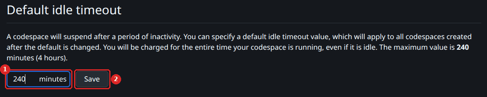
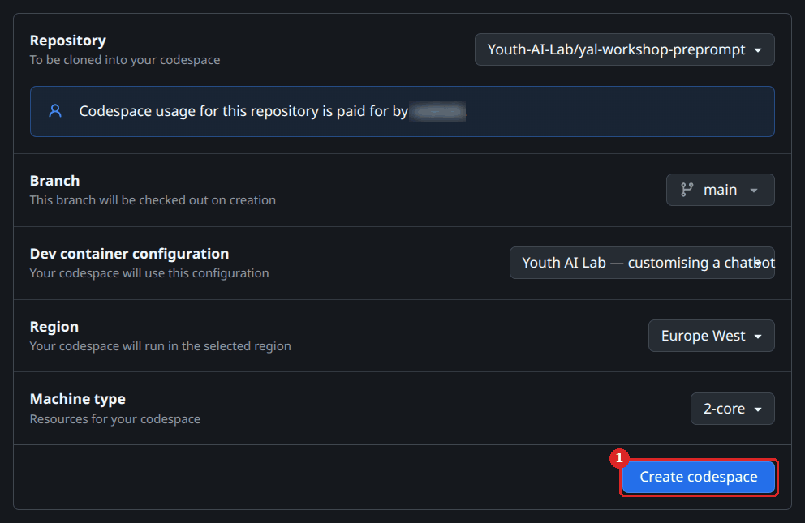
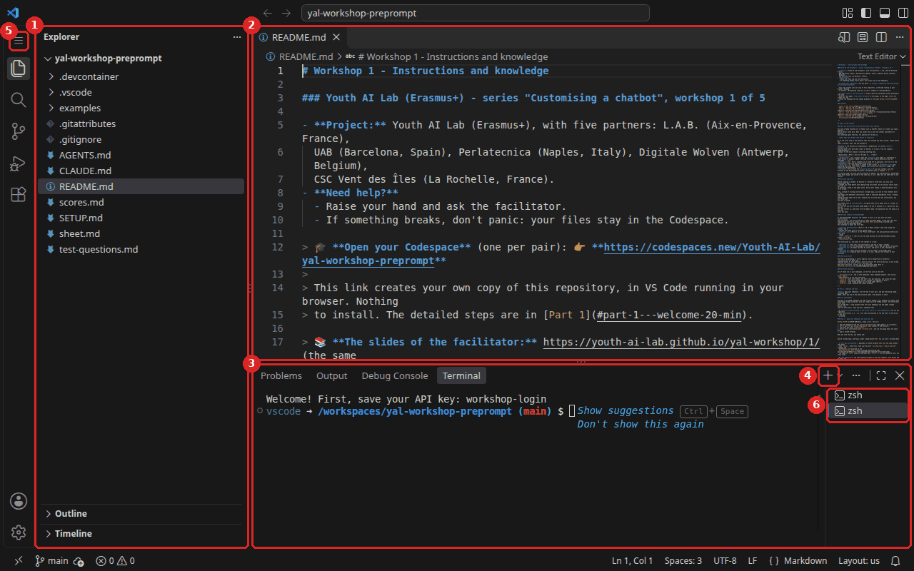
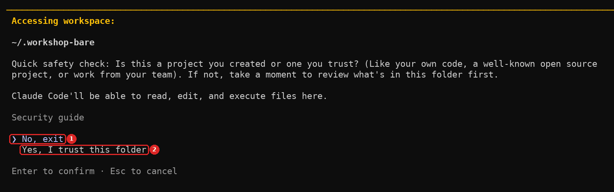
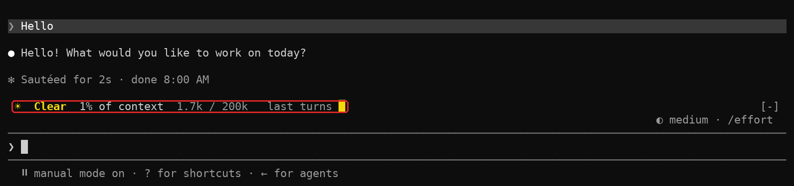

# Setup, commands and common problems

The same for all the workshops of the series "Build your own chatbot" (Youth AI Lab, Erasmus+).
The page of each workshop is its `README.md`.

- [Before you start](#before-you-start)
- [Setup](#setup)
- [Memo - The commands](#-memo---the-commands)
- [Memo - The words of the series](#-memo---the-words-of-the-series)
- [Troubleshooting](#troubleshooting)

---

## Before you start

### What you need to know

- **No programming**: you type about ten commands per workshop in a terminal. They are all
  written in the pages: copy and paste them.
- **A little English**: the chatbot, the commands and these pages are in English. Some official
  documents are in French, Italian, Catalan or Dutch. Dates and numbers are easy to compare in
  any language.
- **No expertise on wildfires**: the documents are here.
- **Your pair**: you work two by two, on one screen. Change who types at each part.

### Your environment

You work in a **GitHub Codespace**: a text editor (VS Code) running in your browser, on a
computer of GitHub. The editor and the terminal are ready. (Workshop 6 installs its own libraries with `./sorter setup`.) You need **one free GitHub account per
pair**. The facilitator gives each pair an **API key**: a long password that lets your
Codespace use Anthropic's model. The facilitator caps what the keys can spend, and each key only
works for a short time.

The chatbot runs in **Claude Code**, a program that lets a model work in a folder of files. We
use it because it **shows everything**: what the model reads, searches and does.

> ℹ️ **Note.** **This is intentional.** Claude Code is not the tool you will use with young
> people. It is a glass box: the same mechanisms as in a chat tool, but you can see inside.

> 💡 **If you use OpenCode.** OpenCode is another program that runs the same chatbot, with the
> same commands. Save your key with `workshop-login --engine opencode`. It also accepts an
> OpenRouter key, to try other models. See the
> [OpenCode guide](https://github.com/Youth-AI-Lab/yal-opencode-guide), and
> [Part 2 - What OpenCode does, compared with Claude Code](https://github.com/Youth-AI-Lab/yal-opencode-guide#part-2---what-opencode-does-compared-with-claude-code).

> ℹ️ **No Codespace?** (blocked network, used-up quota) The same repository opens on your own
> computer, with Docker and VS Code: see the
> [dev containers guide](https://github.com/Youth-AI-Lab/yal-devcontainer-guide). For a model that
> runs on a computer of your organisation: the
> [local AI guide](https://github.com/Youth-AI-Lab/yal-local-ai-guide).

---

## Setup

Do these steps **at the start of each workshop**, in a new Codespace. They take about 5 minutes.

### Step 1 - Let the Codespace wait for you

By default, a Codespace stops after **30 minutes** without activity. You lose nothing, but it
takes about 30 seconds to restart. Change this **before you create your Codespace**: the setting
only applies to the Codespaces created after it. You do it once for your GitHub account. If you
did it at an earlier workshop, go to step 2.

1. **Sign in to GitHub** with the account of one of you (a free account is enough).
2. **Open** https://github.com/settings/codespaces.
3. **Find** the setting **"Default idle timeout"**, lower on the page.
4. **Type 120** in the box (or more: the maximum is 240), then **click "Save"**.



### Step 2 - Open your Codespace

1. **Open the Codespace link** at the top of the README of your workshop. Each workshop has its own link. For workshop 1:

   👉 **https://codespaces.new/Youth-AI-Lab/yal-workshop-preprompt**

2. **Click** the button **"Create codespace"**. Leave the other choices as they are.

   

3. **Wait about 2 minutes** while the Codespace is built.

You should see VS Code in your browser: the **list of files** on the left (`AGENTS.md`,
`README.md`, `SETUP.md`…), and a **terminal** at the bottom of the screen. The
terminal is where you type commands. If you don't see it, open the menu (☰) at the top left,
then **"Terminal"**, then **"New Terminal"**.



> ⚠️ **Important.** **Use the same Codespace all workshop long**: do not create a new one each
> time. If it stops after a long pause, reopen it from **https://github.com/codespaces**: nothing
> is lost. At the end of the workshop, save your work with `workshop-save`.

### Step 3 - Save the key of your pair

1. **Copy the key** that the facilitator gave you. Copy the **whole** key: one long word that
   starts with `sk-ant-`.
2. **Click in the terminal**, at the bottom of the screen.
3. **Type** this command, then press **Enter**:

   ```bash
   workshop-login
   ```

4. **Paste the key** when the terminal asks for it: `Ctrl+Shift+V` (`Cmd+V` on a Mac), or
   right-click, then **Paste**:

   ```
   Paste the API key of your pair, then press Enter:
   ```

   > 💡 The key itself is **not shown**: you see one `*` per character instead. This is
   > normal: it is a password. The first time, the browser may ask for permission to paste:
   > accept, then check that the `*` appeared. **Paste only once.**

5. **Press Enter.** The key is tested at once, with a very small request to the model.

You should see (with the start and the last 4 characters of your key):

```
Key received: sk-ant-…a1b2 (… characters). Testing it…
Key OK (Claude Code, Anthropic, model claude-sonnet-5-5). You can start: workshop bare
```

In workshop 6, the line ends with `workshop-start 6`.

If you see another message, look at [Troubleshooting](#troubleshooting).

### Step 4 - Your first conversation

> ℹ️ **Note.** **Workshop 6** has no chatbot: skip steps 4 and 5, and go to step 6.

1. **Type**:

   ```bash
   workshop bare
   ```

   You should see this line, then the screen of Claude Code:

   ```
   Workshop: mode bare. To quit: press Ctrl+C twice. Other modes: workshop bare | A | B | C
   ```

   The list shows the modes of this repository: it grows from one workshop to the next.

2. **The first time**, a few screens come one after the other. None of them is a problem:
   - your **browser** may ask whether the page can use the fonts installed on your computer:
     click **Allow** (or Block: both work);
   - Claude Code asks you to **choose a text style** (theme): keep the one proposed and press
     **Enter**;
   - it shows **Security notes**: press **Enter** to continue;
   - it may ask "Use Claude Code's terminal setup?": choose `2. No, maybe later with
     /terminal-setup` and press **Enter**;
   - it asks whether you **trust the folder** ("Quick safety check"). **Careful: the choice
     proposed is `No, exit`**, and Enter alone closes Claude Code. Press the **down arrow** to
     choose `Yes, I trust this folder`, then **Enter**;

     

   - it reminds you that **Claude can make mistakes**: press **Enter**;
   - it says **"Welcome to Claude Code for VS Code"**: press **Enter** to continue.

   It asks once more to trust a folder the first time you start a mode other than `bare`: these
   modes work in the folder of the workshop. Choose `Yes, I trust this folder` again. If Claude
   Code closed, type the same command again.
3. **Look above the input box**: a line like `Clear 0% of context 0 / 200k` shows how full the
   **context window** is (200k = 200,000 tokens; a token is a piece of a word). This is **the
   gauge**. Keep an eye on it.
4. **Type a first message**, for example `Hello`, and press Enter. Read the answer, and look at
   the gauge again:

   

5. **Leave** the conversation: press **Ctrl+C twice**. You are back in the terminal.

Commands that start with `/` are typed **inside** a conversation; they work from mode C on (in
modes bare, A and B they are switched off on purpose, and `/exit` says "Unknown command"). All
other commands are typed in the terminal, **outside** a conversation.

### Step 5 - Open a second terminal

Some commands take time. A second terminal lets you go on working in the first one.

1. **Click the `+`** at the top right of the terminal panel.
2. A new terminal opens. You can switch between the two in the list on the right of the panel.

### Step 6 - Get ready for the workshop of the day

**Type** `workshop-start` and the number of the workshop, written at the top of its README. For
workshop 1:

```bash
workshop-start 1
```

It opens the README of the workshop, and tells you the first command to type. With the work you
saved last time, for workshop 2 for example: drag `my-work.zip` into the file list, then type
`workshop-start 2 --from my-work.zip`.

If you got `Key OK`, a first conversation and `Ready for workshop …`, **everything is ready**.

---

## 📋 Memo - The commands

| Command | Where to type it | What it does |
|---|---|---|
| `workshop-login` | terminal | saves the key of your pair and tests it |
| `workshop-start <n>` | terminal | gets the Codespace ready for workshop n, and opens its page |
| `workshop <mode>` | terminal | starts a conversation with the chatbot in one **mode**: `bare`, `A`, `B`, `C`, `D`, `E` or `F` |
| `replay <mode>` | terminal | asks all your test questions in this mode, one new conversation per question, and writes the answers in `answers/` |
| `replay <mode> 8 11` | terminal | the same, only for questions 8 and 11 |
| `replay A --agents examples/AGENTS.liar.md` | terminal | the same, with other instructions than `AGENTS.md` (workshop 1) |
| `score <mode> --blind` | terminal | you score the latest answers of this mode, then a judge shows its score |
| `score <mode>` | terminal | the judge proposes a score, you accept it (Enter) or correct it |
| `workshop-save` | terminal | packs your work into `my-work.zip`, to download at the end of each workshop |
| `workshop help` | terminal | what each mode puts in the context |
| `openwebui start` | terminal | starts Open WebUI in your Codespace; `openwebui chatbot --name "…"` adds your own chatbot; `openwebui help` for more |
| `Ctrl+Shift+V` | in an open `.md` file | shows it as a readable page: titles, tables, lists (`Cmd+Shift+V` on a Mac) |
| `Ctrl+Shift+C` / `Ctrl+Shift+V` | terminal | copy / paste in the terminal, also inside a conversation (`Cmd+C` / `Cmd+V` on a Mac) |
| `Ctrl+C` twice | in a conversation | leaves the conversation (all modes) |
| `Ctrl+O` | in a conversation | unfolds the steps of an answer: files read, searches, tools (from workshop 3); `Ctrl+O` again to come back |

The commands of the later workshops (`corpus-add`, `wiki-start`, `wiki-graph`, `wiki-explore`,
`chatbot-export`, `/context`, `/mcp`) are explained in their pages. The **mode** letters are not
case-sensitive: `workshop a` works as well as `workshop A`.

> ⚠️ **Important.** **To copy and paste in the terminal**, use `Ctrl+Shift+C` and `Ctrl+Shift+V`
> (`Cmd+C` and `Cmd+V` on a Mac), or right-click, then **Copy** or **Paste**. In the terminal,
> `Ctrl+C` alone does **not** copy: it stops what is running, and twice it leaves the
> conversation. Click in the terminal before you paste: in an open `.md` file, `Ctrl+Shift+V`
> shows the preview instead.

> 💡 **Tip.** **To read a Markdown file** (a file whose name ends in `.md`), open it, then press
> `Ctrl+Shift+V` (`Cmd+Shift+V` on a Mac), or right-click on it in the file list and choose
> **"Open Preview"**. **To write in a file** (`AGENTS.md`, `scores.md`…), stay in the normal
> editor, where you can type.

## 📋 Memo - The words of the series

Each word is explained again the first time a workshop uses it.

| Word | What it means here |
|---|---|
| **Kit** | The repository with everything the first five workshops use, in one place: [yal-workshop-kit](https://github.com/Youth-AI-Lab/yal-workshop-kit). Each workshop has its own repository, with only what it needs. |
| **Model** | A program whose behaviour comes from numbers found by training. In workshops 1 to 5, Claude Sonnet writes the answers, the same for every pair. In workshop 6, a small model chooses a class. |
| **Context** (or **context window**) | Everything the model reads before it answers. It has a maximum size: here, 200,000 tokens. |
| **Token** | The unit used to measure text for a model: a piece of a word. On average, 4 characters of English text. |
| **System prompt** | Instructions the model reads at the start of every conversation: who it is, its rules. |
| **Judge** | Another model, smaller, that scores an answer with the same rules as you. It can be wrong too. |
| **Corpus** | The collection of official documents the chatbot can use. |
| **Summary** | A short text in English about one document, written by the model, then checked against the document (by a person for those marked human-reviewed). |
| **RAG** | *Retrieval-Augmented Generation*: a search engine picks pieces of documents, and only these pieces go to the model. |
| **Skill** | A procedure written in plain English (a file `SKILL.md`): the model opens it only when your request matches its description, then follows its steps. |
| **MCP** | *Model Context Protocol*: a standard way to give a tool to a model (here, a tool that reads live data). |
| **Wiki** | Pages organised by topic, linked together, each fact with a note that gives its source. |

---

## Troubleshooting

The problems of one workshop are at the end of its page. Here are the common ones.

**`Nothing was pasted.`** - The paste did not arrive (often the first time, when the browser asks
for permission, or because `Ctrl+V` does not paste in the terminal). Type `workshop-login` again
and paste the key once with `Ctrl+Shift+V` (`Cmd+V` on a Mac): you should see the `*`.

**`The key seems to have been pasted twice.`** - Type `workshop-login` again and paste the key only once.

**`This does not look like a key (it should start with sk-ant-, or sk-or- for OpenRouter with OpenCode). Nothing saved.`** -
The text you pasted is not a whole key. Copy it again, with nothing before or after it, and type
`workshop-login` again.

**`This is an OpenRouter key: Claude Code in the workshop needs an Anthropic key (sk-ant-…).`** -
The workshop uses an Anthropic key (it starts with `sk-ant-`): ask the facilitator for the key of
your pair. An OpenRouter key (`sk-or-`) works only with the other engine, OpenCode:
`workshop-login --engine opencode`.

**`The saved key is an OpenRouter key: it works with OpenCode only (workshop-login --engine opencode).`** -
Your key is saved, but `workshop` was started with Claude Code, which needs an Anthropic key
(it starts with `sk-ant-`). Either go back to OpenCode with `workshop-login --engine opencode`,
or type `workshop-login` and paste an Anthropic key.

**`Key saved, but Anthropic refuses it (HTTP 401). Check it with the facilitator.`** - The key
was saved, but it does not work. Tell the facilitator.

**`Key saved, but Anthropic could not be reached (network?). Try: workshop bare`** - The network
did not answer during the test. Your key is saved: try `workshop bare` (in workshop 6, the
message says `workshop-start 6`). If it fails, ask the facilitator.

**`Anthropic refuses this key (HTTP 401). Your earlier key is kept.`** - The new key was not
saved: the chatbot still uses your earlier key. Check the new one with the facilitator.

**`Key saved, but the test answered HTTP <code> (model <model>). Tell the facilitator.`** - Show
the message to the facilitator.

**`No API key yet. Type: workshop-login`** - You have not saved your key yet. Do
[Setup, step 3](#step-3---save-the-key-of-your-pair).

**`Unknown mode: Z. Modes: bare, A, B, C, D, E, F (workshop help).`** - Check the letter after
`workshop` or `replay`.

**`Mode D comes with workshop 4. This repository does not have its files.`** - Each workshop has
its own repository. Here, use a mode of the list shown when the chatbot starts. `workshop` alone
means mode D: type the mode, for example `workshop A`.

**"I cannot leave the conversation!"** - Don't panic. Press `Ctrl+C` twice. (`/exit` works only
from mode C on; in modes bare, A and B it says "Unknown command".)

**I see `*` instead of my key.** - This is normal: the key is hidden, like a password. You see
one `*` per character. Paste it once, then press Enter.

**In `replay`, a line says `ERROR: …`.** - This answer failed: in the file it is marked
`**ERROR, do not score this one: …**`. If you see
`Three errors in a row: stopping. Check the key (workshop-login) and the network.`, check your
key, then ask the facilitator.

**`Warning: the model looked at the test material.`** - The model opened `test-questions.md`,
`scores.md`, `answers/` or `examples/` to answer. It may have copied the expected answer: score this answer
0.

**`replay` takes a long time.** - Each question is a new conversation. You can go on working in
your other terminal. If time is short, the facilitator may ask you to replay only some
questions, for example `replay A 7 9`.

**`Docker is not available here, and Open WebUI needs it.`** - In a Codespace, Docker starts a
few seconds after the Codespace: wait one minute and type `openwebui start` again. On your own
computer, see the
[dev containers guide](https://github.com/Youth-AI-Lab/yal-devcontainer-guide#openwebui-says-that-docker-is-not-available).

**`Open WebUI is not running, or not ready yet.`**, or the Open WebUI page does not answer. - It
stops with the Codespace. Type `openwebui start` again: your knowledge and your chatbots are kept.

**`Your key changed since Open WebUI started.`** - You saved a new key with `workshop-login`.
Type `openwebui start`: Open WebUI starts again with the new key.

**The Codespace stopped.** - It stops after a long pause. Reopen it from
https://github.com/codespaces: nothing is lost. To avoid it with your next Codespaces, see
[Setup, step 1](#step-1---let-the-codespace-wait-for-you).

**Something else?** - Raise your hand: the facilitator is here for this. Your files stay in the
Codespace.

---

*Youth AI Lab (Erasmus+) - Series "Build your own chatbot" - 2026*
